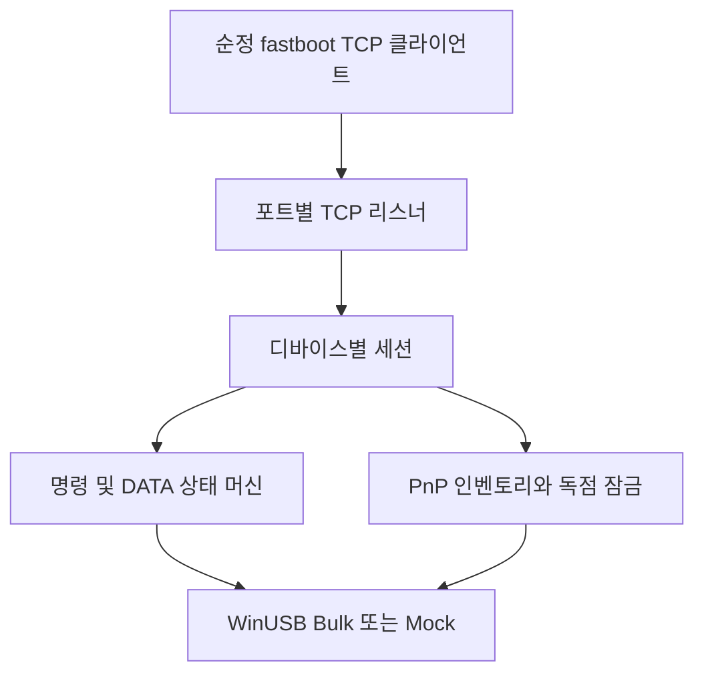

# 아키텍처

| 파일 | 역할 |
| --- | --- |
| `main.cpp`, `config.cpp` | Windows 유니코드 CLI, 진단, 제한 있는 JSON 설정 |
| `socket.cpp`, `server.cpp` | Winsock2, FB01 협상, Allowlist, 포트별 수락과 단일 작업 스레드 |
| `protocol.cpp` | 프레임 길이 검증, 명령·DATA·최종 응답 처리, 64 KiB 스트리밍 |
| `devices.cpp`, `winusb.cpp` | PnP 목록, 위치 기반 실제 장치 잠금, WinUSB 전송·취소, 분리 감지 |
| `mock.cpp` | 테스트용 디바이스 상태와 분리, Bulk 분할·ZLP·오류 시뮬레이션 |

각 포트는 수락 스레드와 작업 스레드 하나를 둡니다. 장치가 없거나 세션이 사용 중이면 그 연결을 종료하고 리스너를 유지합니다. 핸드셰이크 전에 피어의 버전과 USB 접근 가능성을 확인하므로 클라이언트는 새 TCP 연결을 시도할 수 있습니다. 순정 클라이언트는 연결 대기 시 보통 1초 간격으로 재시도합니다. 초기 연결은 Windows PnP 인벤토리에서 고른 장치의 WinUSB 인터페이스를 열고 실제 USB 디스크립터를 다시 확인합니다.

정적 선택자는 시리얼, 명시적인 위치, 필요시 모드별 시리얼 별칭을 사용합니다. 자동 재연결 시 첫 성공 세션의 위치가 유지됩니다. 공유 인벤토리에서 장치 잠금을 얻고 WinUSB 핸들을 독점 모드로 엽니다. 다른 매핑이 같은 물리 위치를 가리켜도 동시에 열 수 없습니다. 현재 USB 핸들에는 PnP 제거 알림을 사용하고 200ms 목록 갱신으로 변화를 보완합니다. 목록에서 제거되거나 핸들의 제거 이벤트를 받으면 해당 USB 세대를 폐기합니다.

명령 쓰기를 시작하면 상태는 결과 대기로 이동합니다. 최종 `OKAY` 또는 `FAIL`을 읽기 전에 I/O가 끊기면 로그에 결과 불명을 남기고 현재 USB 연결을 격리합니다. 정상 응답을 읽은 뒤 TCP 전달만 실패한 경우 서버는 해당 명령의 USB 응답을 이미 받은 상태입니다. 서버는 연결 복구 시 명령을 재전송하지 않습니다.

`reboot`, `reboot-*`, `boot`, `continue`, `shutdown`의 실제 `OKAY`를 TCP로 보낸 뒤 세션을 닫고 기존 USB 분리를 확인합니다. 확인 중에는 같은 포트의 새 연결을 거부합니다. 분리가 확인되면 새 USB 연결의 정체성을 재검증해 기존 매핑을 사용합니다. 분리가 제한 시간 내 확인되지 않으면 격리합니다. USB 포트에 사람이 다시 꽂거나 Windows 절전으로 경로가 바뀌는 경우에도 같은 규칙을 적용합니다.

## 개발 단계

| 단계 | 구현 및 확인 |
| --- | --- |
| 1 조사 | AOSP main 고정 커밋, 이전 릴리스 태그, Google USB INF, Microsoft API, 관련 오픈소스 조사 |
| 2 TCP | FB01, 8바이트 길이, Mock 및 순정 `getvar` |
| 3 Windows USB | SetupAPI, Config Manager, WinUSB 전송, x64 교차 컴파일 |
| 4 DATA | USB 명령 경계와 TCP 분할 분리, 양방향 스트리밍, 해시 검증 |
| 5 재연결 | 포트별 세션, 실제 위치 잠금, Mock 모드 왕복과 복합 클라이언트 명령 |
| 6 배포 | CLI, 진단, 보안 설정, CTest, PowerShell 및 GitHub Actions, ZIP |

실제 Windows USB 확인 절차는 [실기기 테스트 계획](TEST_PLAN.md)에 있습니다.
